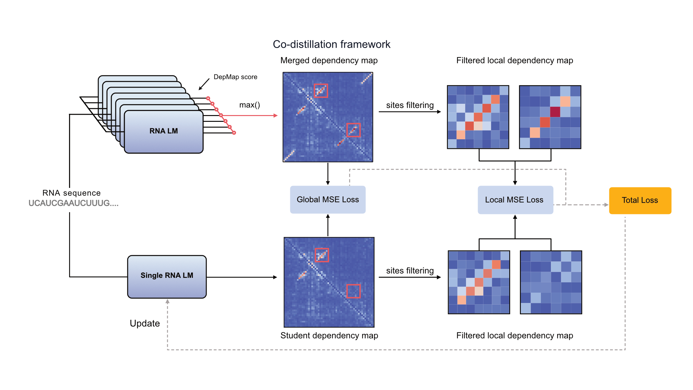

# RNAcompass: Conserved RNA structure prediction from single sequences

- [Installation](#installation)
- [Quick start](#quick-start)
- [Usage](#usage)
- [Reproducibility](#reproducibility)
- [License](#license)

RNAcompass is a co-distilled RNA language model for identifying conserved RNA
structural signals from a single sequence. This repository provides the public
v1 inference pipeline, from dependency-map generation to candidate base pairs
and helices.

The associated manuscript, *Distilling complementary knowledge across RNA
language models reveals conserved structures from single sequences*
<p align="center">
  
</p>

- **Pretrained weights:** Download the two public checkpoints from
  [Google Drive](https://drive.google.com/drive/folders/1qIOZfk1cOgqKFd04wXXeLpuGF18qphBz?usp=sharing).
  See the [weight specification](docs/weights.md).
- **Reproducibility:** A reference input and expected outputs are included in
  the repository. See the [validation guide](docs/reproducibility.md).

## Installation

Linux, Conda, an NVIDIA GPU with a CUDA 11.3-compatible driver, Python 3.9.16.

```bash
git clone https://github.com/ZhaoRB1/RNAcompass.git && cd RNAcompass
conda env create -f environment.yml
conda activate rnacompass
python -m pip install -e .

# fairseq must be installed separately: its default build compiles CUDA
# extensions and pulls torchaudio, which conflicts with pytorch=1.10.0.
python -m pip install cython bitarray regex sacrebleu packaging \
  "tqdm==4.66.2" "hydra-core==1.0.7" "omegaconf==2.0.6"
READTHEDOCS=1 python -m pip install --no-deps --no-build-isolation "fairseq==0.12.2"

# Required on clusters that export a system CUDA path, otherwise the first
# matrix multiply fails with CUBLAS_STATUS_NOT_SUPPORTED.
unset LD_LIBRARY_PATH
```

CPU inference is not supported in v1.

## Quick start

Download the two checkpoints, verify the environment, and run the example
sequence:

```bash
WEIGHTS_DIR="${XDG_CACHE_HOME:-$HOME/.cache}/rnacompass/weights/v1"
mkdir -p "$WEIGHTS_DIR/base" "$WEIGHTS_DIR/distilled"

curl -L --fail --retry 5 --continue-at - \
  -o "$WEIGHTS_DIR/base/checkpoint_12_960000.pt" \
  "https://drive.usercontent.google.com/download?id=1bBG45EQi1TZKxYiZS3jpt8ePprHFlzGz&export=download&confirm=t"

curl -L --fail --retry 5 --continue-at - \
  -o "$WEIGHTS_DIR/distilled/vernie_rna_giga_irf_epoch002.pth" \
  "https://drive.usercontent.google.com/download?id=1rz-QT529q64kymgW4E__i0vGEoP2VLMj&export=download&confirm=t"

rnacompass weights status --check-hashes
rnacompass preflight --device cuda:0
rnacompass run \
  --fasta examples/RF00001.fa \
  --output-dir output \
  --device cuda:0
```

Checkpoints you already have can be reused: keep the two filenames above, then
point `RNACOMPASS_WEIGHTS_DIR` (or `--weights-dir`) at that directory instead of
the default cache path.

## Usage

RNAcompass accepts one FASTA file or a directory of `.fa`, `.fasta`, and `.fna`
files. To process a directory:

```bash
rnacompass run \
  --fasta-dir /path/to/fastas \
  --output-dir output \
  --device cuda:0 \
  --batch-size 4
```

Use `--dry-run` to validate inputs without loading PyTorch or the model weights:

```bash
rnacompass run --fasta examples/RF00001.fa --output-dir output --dry-run
```

Each sample produces dependency maps, predicted base pairs and helices, a JSON
summary, and PDF/SVG/PNG heatmaps under `output/results/<sample>/`. The model
supports sequences up to 1,022 nt. Run `rnacompass run --help` for all options.

### Using multiple GPUs

Each process drives exactly one GPU, selected by `--device cuda:N`. To use
several cards, run one process per card and split the input between them:

```bash
for i in 0 1 2 3; do
  rnacompass run \
    --fasta-dir "fastas/shard_$i" \
    --output-dir "output/shard_$i" \
    --device "cuda:$i" &
done
wait
```

The processes are independent: they share no state and do not need a launcher.
Running the same input on one card or another gives identical output.

## Reproducibility

The CPU test suite covers input handling, structural filtering, output schemas,
weight validation, and packaging:

```bash
python -m pip install -e ".[test]"
pytest -m "not gpu"
```

GPU reference validation and acceptance criteria are documented in
[docs/reproducibility.md](docs/reproducibility.md).

## License

RNAcompass source code and trained model parameters are released under the
[MIT License](LICENSE), which also preserves the notice for the bundled
ERNIE-RNA-derived source code.
